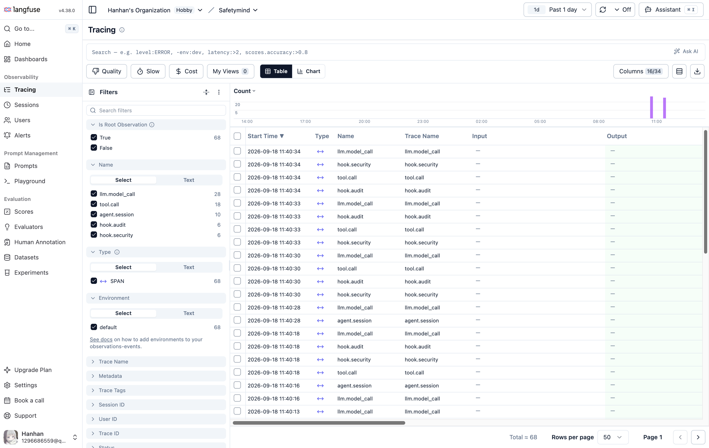
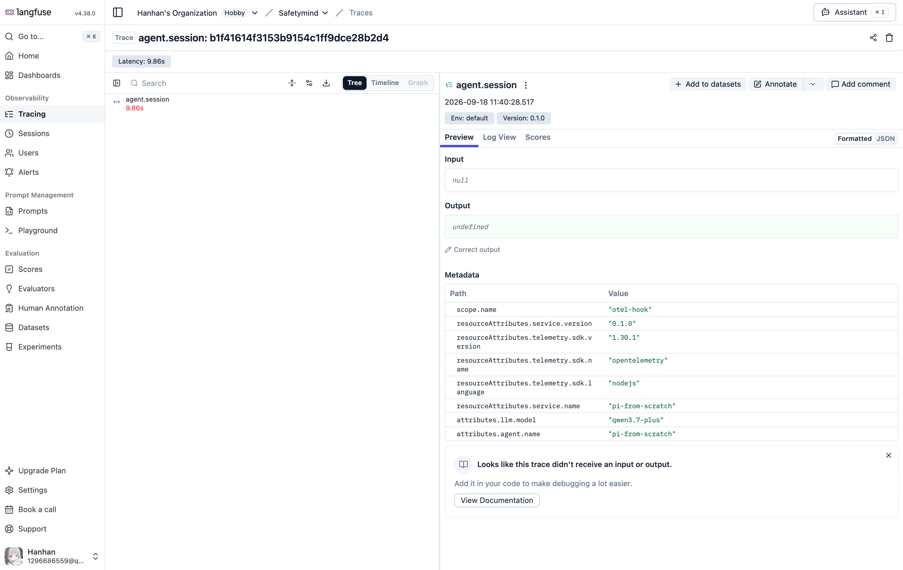
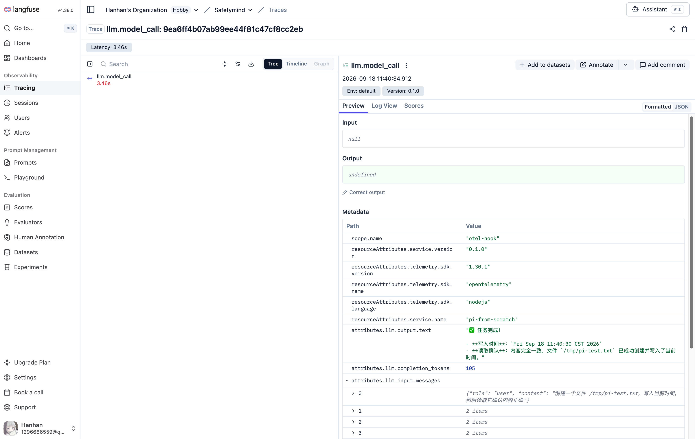
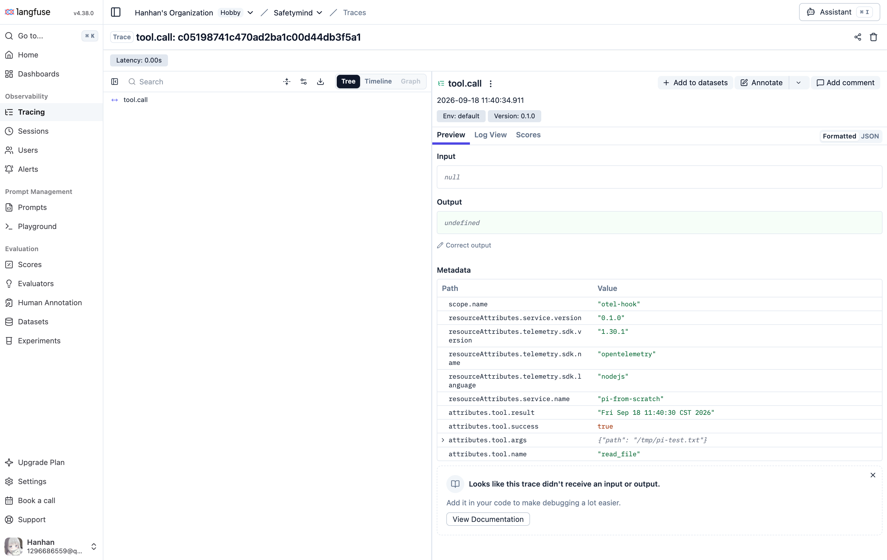
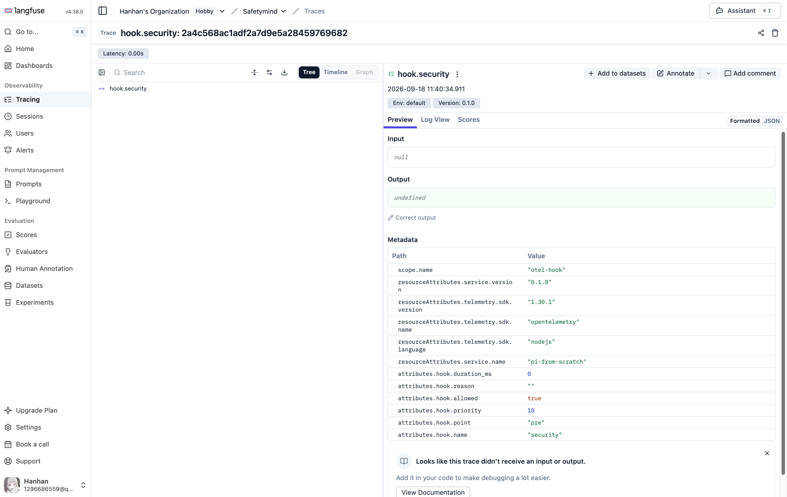

# otel-hook

基于 OTLP 协议的智能体 trace 采集和 hook 实现 SDK.

## 概述

此 SDK 负责：

1. 初始化 OpenTelemetry TracerProvider
2. 提供 Hook 注册、优先级编排的机制
3. 自动为每个 hook 执行创建 span（记录耗时、错误）
4. 收集并返回所有 hook 的返回值
5. 智能导出 traces（能发就发，发不出就缓存）
6. **StreamGuard 三门流式安全防线**（策略包内生能力）：Qwen3Guard-Stream-4B 本地安全小模型对输入/流式输出/终检做增量审核，hold-back 零暴露、fail-closed、Langfuse 全量归因 → [使用指南](docs/stream-guard.md) ｜ [攻防验证报告](docs/Safetymind_Pi_Attack_Defense_Report.md)

**Hook 就是插入一段代码。** 你在里面写什么逻辑都行——发通知、记日志、改参数、抛异常、返回任意东西。SDK 只负责执行和记录，不解释返回值。

注：本 SDK 采取 hook 和 span 分离的设计，未来可能进一步支持 hook 机制内置到 span（统一埋点）的设计。

## 项目结构

```
otel-hook-sdk/
├── otel-hook-py/           # Python SDK
│   ├── otel_hook/
│   ├── tests/
│   └── pyproject.toml
├── otel-hook-ts/           # TypeScript SDK
│   ├── src/
│   └── tests/
├── otel-hook-strategies/   # Python 策略包（示例）
├── otel-hook-strategies-ts/# TypeScript 策略包（含 StreamGuard 三门防线）
│   └── src/security/stream-guard.ts
├── deploy/                 # 部署脚本
│   ├── qwen3guard_server.py   # Qwen3Guard-Stream-4B 审核服务（MPS/CUDA）
│   └── tests/                 # 攻防实验产物存档
├── docs/                   # 文档与截图
│   ├── stream-guard.md        # StreamGuard 使用指南
│   ├── Safetymind_Pi_Attack_Defense_Report.md  # 19 家族攻防验证报告
│   └── Safetymind_Demo_Documentation.md        # 原型 demo 文档
├── README.md
├── STRATEGIES.md           # 策略编写指南
└── Safetymind原型开发.md    # 原型开发记录
```

## 安装

```bash
git clone https://github.com/soft-zihan/otel-hook-sdk.git
cd otel-hook-sdk

# Python SDK
cd otel-hook-py && pip install -e .

# TypeScript SDK
cd otel-hook-ts && npm install && npm run build

# TypeScript 策略包（StreamGuard 三门防线 / Qwen3GuardHook / 过滤 / 审计）
cd otel-hook-strategies-ts && npm install && npm run build

# 安全小模型审核服务（StreamGuard 后端）
cd deploy && python3 -u qwen3guard_server.py --port 8000 --device mps
```

## 快速开始

### 1. 初始化

```python
from otel_hook import setup_tracing

setup_tracing(
    service_name="my-agent",
    otlp_endpoint="http://localhost:4317",  # OTLP endpoint，可选
    cache=True,                              # 离线时缓存到 SQLite
)
```

```typescript
import { setupTracing } from 'otel-hook'

setupTracing({
  serviceName: 'my-agent',
  otlpEndpoint: 'http://localhost:4317',
  cache: true,
})
```

### 2. 埋点

在你的代码中创建 span，SDK 会自动记录到 OTel：

```python
from otel_hook import get_tracer, SpanNames

tracer = get_tracer()

# Session span
session_span = tracer.start_span(SpanNames.AGENT_SESSION, {
    'agent.name': 'my-agent',
    'llm.model': 'gpt-4o',
})

# Model call span
model_span = tracer.start_span(SpanNames.MODEL_CALL, {
    'llm.model': 'gpt-4o',
    'llm.input.messages': json.dumps(messages),
})

# Tool call span
tool_span = tracer.start_span(SpanNames.TOOL_CALL, {
    'tool.name': 'read_file',
    'tool.args': json.dumps(args),
})
```

```typescript
import { getTracer, SpanNames } from 'otel-hook'

const tracer = getTracer()

const sessionSpan = tracer.startSpan(SpanNames.AGENT_SESSION, {
  [SpanAttributes.AGENT_NAME]: 'my-agent',
  [SpanAttributes.LLM_MODEL]: 'gpt-4o',
})
```

### 3. 编写 Hook

Hook 就是一个函数，接收 `HookContext`，**做什么完全由你定义**：

```python
from otel_hook import HookContext, HookResult

# 示例 1：安全检查
def security_hook(ctx: HookContext) -> HookResult:
    tool_args = ctx.data.get('tool.args', '')
    if 'rm -rf' in tool_args:
        return HookResult(allowed=False, reason='dangerous command')
    return HookResult(allowed=True)

# 示例 2：审计日志
def audit_hook(ctx: HookContext) -> HookResult:
    print(f"[AUDIT] {time.time()}")
    return HookResult(allowed=True)

# 示例 3：修改参数
def sanitize_hook(ctx: HookContext) -> HookResult:
    args = ctx.data.get('args', {})
    args['path'] = args['path'].replace('..', '')
    return HookResult(allowed=True, data={'args': args})
```

```typescript
import { HookContext, HookResult } from 'otel-hook'

// 示例 1：安全检查
function securityHook(ctx: HookContext): HookResult {
  const toolArgs = ctx.data['tool.args'] || ''
  if (toolArgs.includes('rm -rf')) {
    return { allowed: false, reason: 'dangerous command' }
  }
  return { allowed: true }
}

// 示例 2：审计日志
function auditHook(ctx: HookContext): HookResult {
  console.log(`[AUDIT] ${Date.now()}`)
  return { allowed: true }
}

// 示例 3：修改参数
function sanitizeHook(ctx: HookContext): HookResult {
  const args = ctx.data.args || {}
  args.path = args.path.replace('..', '')
  return { allowed: true, data: { args } }
}
```

### 4. 注册 Hook

```python
from otel_hook import register_hook

register_hook("tool_call", security_hook, "security", priority=10)
register_hook("tool_call", audit_hook, "audit", priority=1000)
```

```typescript
import { registerHook } from 'otel-hook'

registerHook("tool_call", securityHook, "security", 10)
registerHook("tool_call", auditHook, "audit", 1000)
```

### 5. 执行 Hook

在需要拦截的地方调用 `run_hooks`：

```python
from otel_hook import run_hooks, HookContext

ctx = HookContext(data={
    "tool.name": "read_file",
    "tool.args": {"path": "/tmp/test.txt"},
})

results = run_hooks("tool_call", ctx)

# 智能体自己处理结果
for result in results:
    if not result.allowed:
        print(f"Blocked: {result.reason}")
        break
    if result.data:
        # 使用修改后的数据
        args = result.data.get("args", args)
```

```typescript
import { runHooks, HookContext } from 'otel-hook'

const ctx: HookContext = {
  data: {
    "tool.name": "read_file",
    "tool.args": { path: "/tmp/test.txt" },
  },
}

const results = await runHooks("tool_call", ctx)

// 智能体自己处理结果
for (const result of results) {
  if (!result.allowed) {
    console.log(`Blocked: ${result.reason}`)
    break
  }
  if (result.data) {
    // 使用修改后的数据
    args = result.data.args || args
  }
}
```

## StreamGuard 三门流式安全防线

策略包（`otel-hook-strategies`）的内生能力，与具体 agent 框架解耦：喂消息历史（门1）、喂流式 delta（门2，句子级 hold-back）、终检剩余文本（门3）。发布给用户的每个字符都已过检，**拦截 = 零暴露**；后端异常默认 fail-closed。

```
用户输入 ─► 门1 input_gen ─Unsafe≥0.7─► ⛔ 拦截（主模型零调用）
               │ Safe
               ▼
       主模型流式生成（任意 LLM/框架）
               │ 句子级 hold-back
               ▼
       门2 output_stream ─Unsafe─► ⛔ abort 上游流（已发布均为过检文本）
               │ Safe
               ▼
       门3 output_gen 终检 ─► ✅ 发布
```

```typescript
import { createStreamGuard, runGuardedStream, guardServerAlive } from 'otel-hook-strategies'

const guard = createStreamGuard({ endpoint: 'http://localhost:8000', sessionId, userId, parentContext })

const g = await guard.startTurn(messages)            // 门1
if (g.blocked) return showNotice(g.reason)

const r = await runGuardedStream(                     // 门2+门3，source 为任意 delta 流
  signal => myLlmStream(signal), guard,
  { onRelease: chunk => render(chunk) },              // 只回调过检文本
)
if (r.outcome === 'blocked') rollbackTurn(r.blocked)  // 违规原文在 r.blocked.blockedText（未达用户）
```

- 全部可配置：阈值 / failMode / hold-back 分块参数 / 断句器 / span 命名，或 `streamGuardFromEnv()` 走环境变量（`SAFE_GUARD`、`GUARD_THRESHOLD`、`NO_INPUT_BLOCK` 消融模式等）
- 后端可替换：实现 `GuardBackend` 结构化接口即可（默认 `Qwen3GuardHook`，服务部署见 `deploy/qwen3guard_server.py`）
- 每次检测发射 Langfuse GUARDRAIL span（verdict / 置信度 / 延迟 / 拦截点 / 被检文本）
- 已经 19 家族红队攻防验证：详见 [docs/stream-guard.md](docs/stream-guard.md) 与 [攻防报告](docs/Safetymind_Pi_Attack_Defense_Report.md)

## Hook 机制

### 优先级

`priority` 数字越小越先执行。典型优先级：


| 优先级 | 用途                 |
| -------- | ---------------------- |
| 10     | 安全检查（最先执行） |
| 50     | 参数修改             |
| 1000   | 审计日志（最后执行） |

### 自动 Span

SDK 自动为每个 hook 执行创建 span，记录：

- `hook.name` — hook 名称
- `hook.priority` — 优先级
- `hook.duration_ms` — 执行耗时
- `hook.error` — 错误信息（如有）
- `hook.allowed` — 是否放行
- `hook.reason` — 拦截原因

无需应用层手动创建。

## 导出策略


| 场景 | `cache=True`                   | `cache=False` |
| ------ | -------------------------------- | --------------- |
| 在线 | 直接发送                       | 直接发送      |
| 离线 | 缓存 → 恢复后重传 → 过期清理 | 丢弃          |

## 核心 API

### 初始化

```python
setup_tracing(
    service_name: str,
    otlp_endpoint: str | None = None,
    cache: bool = True,
    cache_db_path: str = './data/traces/cache.db',
    retry_interval: int = 5,
    expire_seconds: int = 86400,
)
```

### Hook 接口

```python
@dataclass
class HookContext:
    data: dict  # 当前上下文数据（灵活，按 event 不同而不同）

@dataclass
class HookResult:
    allowed: bool           # True=继续，False=拦截
    reason: str | None      # 拦截原因
    data: dict | None       # 修改后的数据（None=不修改）

Hook = Callable[[HookContext], HookResult]
```

### Span 名称

```python
class SpanNames:
    AGENT_SESSION = 'agent.session'
    MODEL_CALL = 'llm.model_call'
    TOOL_CALL = 'tool.call'
    CHAIN = 'chain'
```

### Span 属性

```python
class SpanAttributes:
    # Session
    SESSION_ID = 'session.id'
    USER_ID = 'user.id'
    AGENT_NAME = 'agent.name'
    AGENT_VERSION = 'agent.version'

    # LLM
    LLM_MODEL = 'llm.model'
    LLM_PROMPT_TOKENS = 'llm.prompt_tokens'
    LLM_COMPLETION_TOKENS = 'llm.completion_tokens'
    LLM_COST = 'llm.cost'

    # Tool
    TOOL_NAME = 'tool.name'
    TOOL_ARGS = 'tool.args'
    TOOL_RESULT = 'tool.result'
    TOOL_SUCCESS = 'tool.success'

    # Hook
    HOOK_NAME = 'hook.name'
    HOOK_PRIORITY = 'hook.priority'
    HOOK_DURATION_MS = 'hook.duration_ms'
    HOOK_ERROR = 'hook.error'
    HOOK_ALLOWED = 'hook.allowed'
    HOOK_REASON = 'hook.reason'

    # Error
    ERROR_MESSAGE = 'error.message'
```

## 数据流

```
Agent 发起操作
    │
    ▼
创建 Span (OTel)
    │
    ▼
执行 Hook ← 插入你的代码
    │
    ▼
执行业务逻辑
    │
    ▼
Span 结束 → SmartExporter
```

### SmartExporter 流程

```
Span 结束
    │
    ▼
尝试 OTLP 导出
    │
    ├── 成功 → 完成
    │
    └── 失败 + cache=True → 写入 SQLite
                                │
                                ▼
                         后台线程定期重试
                                │
                                ├── 成功 → 删除缓存
                                │
                                └── 超过 expire_seconds → 过期清理
```

## Langfuse 可视化

### Traces 总览



### Agent Session



### LLM Model Call



### Tool Call



### Hook Span



### Guardrail Span（StreamGuard）

每次三门检测生成 `hook.SafeGuard.<gate>#<seq>` GUARDRAIL span：verdict/置信度/延迟归因（`guard.server_latency_ms` vs `guard.wall_ms`）、拦截点 `guard.intercept_at_char`、被检文本在 Input；拦截 span 标记 ERROR，可按 level 过滤审计。

## 测试

```bash
# Python SDK
cd otel-hook-py && pytest tests/ -v

# TypeScript SDK
cd otel-hook-ts && npm test

# TypeScript 策略包（含 StreamGuard 25 例，mock 后端无需真实服务）
cd otel-hook-strategies-ts && npm test
```

## 设计原则

1. **纯机制**：SDK 不关心业务逻辑，只提供 Hook 接口和 OTel 集成
2. **代码插入**：Hook 就是插入一段代码，做什么完全由你定义
3. **OTel 原生**：完全兼容 OpenTelemetry 标准
4. **轻量级**：最小化依赖
5. **可插拔**：Hook 动态注册、优先级编排
6. **智能导出**：能发就发，发不出才缓存，恢复了续传，过期清理
7. **机制与策略分层**：核心包（otel-hook）只做机制；安全防线（StreamGuard 三门）、过滤、审计等能力沉淀在策略包（otel-hook-strategies），与具体 agent 框架解耦、可独立配置调用；模型服务独立部署（deploy/）

## License

MIT
